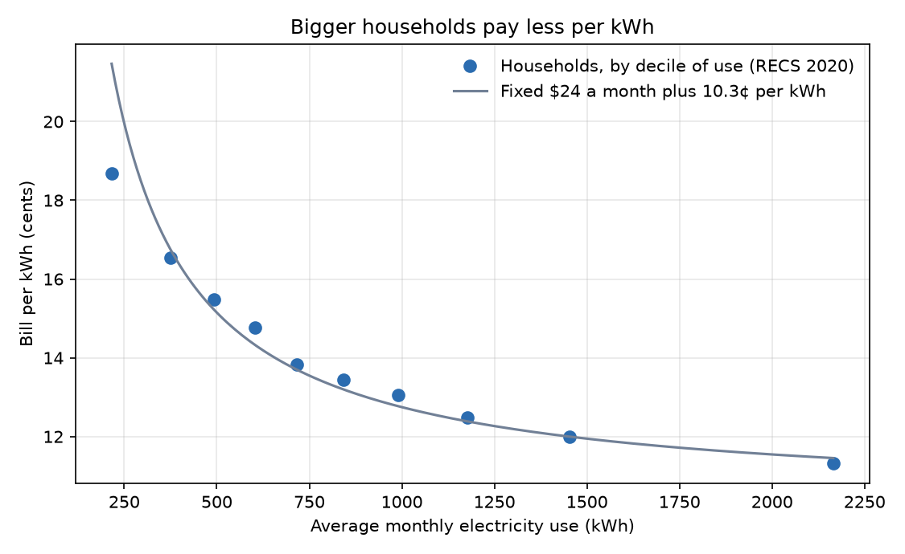
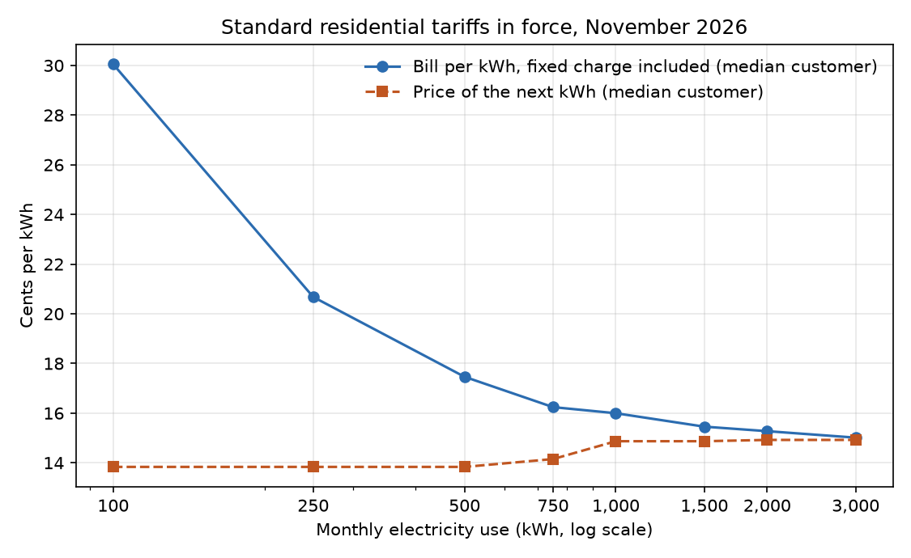
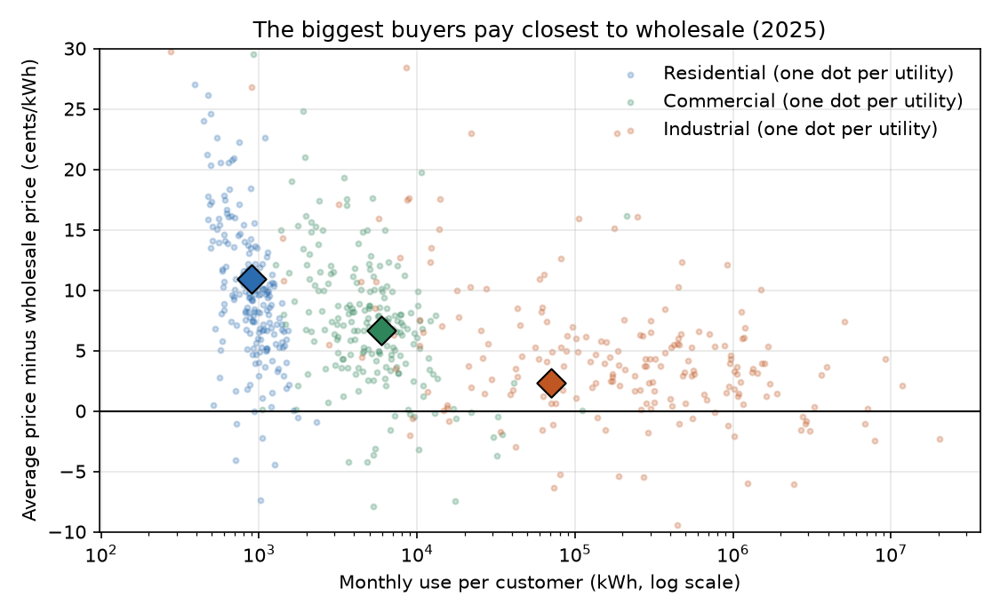

# The Last Kilowatt-Hour

### In 1984, Eric Maskin and John Riley worked out how a seller should price when it cannot tell big buyers from small ones, and pointed to the electric bill as proof. I checked 2026's electricity tariffs to see whether the proof still holds.

---

A family in Chicago on Commonwealth Edison's standard residential rate pays a fixed $19.52 a month before it turns
on a light, and 12.64 cents for every kilowatt-hour after that. If the family uses 500 kilowatt-hours in a month,
the bill works out to 16.54 cents per kilowatt-hour. If it runs an electric dryer and a second refrigerator and uses
1,500, the bill works out to 13.94 cents. In Florida, Florida Power & Light charges 12.26 cents for each of the first
thousand kilowatt-hours and 14.26 cents for each one after that, so the extra power costs more, and yet the bill per
kilowatt-hour still falls from 14.36 cents at 500 to 13.63 cents at 1,500.

Nearly every American electric bill works this way. Heavier users pay less per unit. Whether that is a deliberate
pricing strategy, a by-product of how the wires are paid for, or something regulators impose is a question with a
surprisingly precise answer in economic theory, worked out by two economists who used the utility bill as their
example.

---

## Two prices on every bill

Every electricity tariff hides two prices, and they can move in opposite directions. Write $`T(q)`$ for the total
monthly bill of a customer who uses $`q`$ kilowatt-hours, $`F`$ for the fixed monthly charge, and $`P(q)`$ for the
energy charges. The first price is the bill per kilowatt-hour, which is what a customer feels at the end of the month.
The second is the price of one more kilowatt-hour, which economists call the marginal price.

```math
\frac{T(q)}{q} = \frac{F}{q} + \frac{P(q)}{q},
\qquad
T'(q) = \text{rate on the tier that the next kWh falls into}
```

For the ComEd family the energy charge is a flat 12.64 cents, so the fixed charge does all the work.

```math
\frac{T(500)}{500} = \frac{\$19.52}{500} + 12.64\text{¢} = 16.54\text{¢},
\qquad
\frac{T(1500)}{1500} = \frac{\$19.52}{1500} + 12.64\text{¢} = 13.94\text{¢}
```

The marginal price is 12.64 cents at both levels, so ComEd's tariff is flat at the margin. Florida Power & Light's
rises from 12.26 to 14.26 cents after the first thousand kilowatt-hours, which is called an inclining block. A tariff
whose later blocks are cheaper than its earlier ones is called a declining block.

Maskin and Riley's theory is about the second price. A seller that cannot see how much each customer values the
product should set the price of a customer's last unit above marginal cost $`c`$ by an amount that depends on how
many customers want more. Index customers by a taste parameter $`v`$ with distribution $`F_v`$ and density $`f_v`$,
and write $`p(q;v)`$ for what a customer of type $`v`$ would pay for its $`q`$-th unit.

```math
p\big(q(v);v\big) - c \;=\; \frac{1 - F_v(v)}{f_v(v)} \cdot \frac{\partial p}{\partial v}\big(q(v);v\big)
```

The fraction is the inverse hazard rate. It is large for small customers, because almost everyone uses more than
they do, and it is exactly zero for the largest customer, because no one uses more. If demand curves are straight
lines that differ only in height and today's marginal price is roughly flat, a customer's type is a straight-line
function of its use, and the theory's markup is proportional to the inverse hazard rate of use itself. I measured
that on the 18,481 households in the Energy Information Administration's 2020 Residential Energy Consumption Survey,
which records each sampled home's annual electricity use and spending from its utility's billing data.

| Household | Monthly use | Share using more | Inverse hazard of use | Theory's markup, relative to the median home |
|---|---|---|---|---|
| 10th percentile | 289 kWh | 90% | 1,231 kWh | 1.93 times |
| Median | 754 kWh | 50% | 638 kWh | 1.00 |
| 99th percentile | 2,777 kWh | 1.1% | 529 kWh | 0.83 times |

Read the last column as the theory's instruction to a profit-seeking utility. The 10th-percentile home should pay a
markup on its last kilowatt-hour almost twice the median home's, and the 99th-percentile home about four fifths of
it. A seller following the formula would offer extra kilowatt-hours more cheaply as use rises, which is a declining
block, and bring the price of the last unit down to cost only for its single largest customer.

---

## Eric Maskin and John Riley's question

In 1984 Eric Maskin was at the Massachusetts Institute of Technology and John Riley was at the University of
California, Los Angeles. Their paper, "Monopoly with Incomplete Information," ran 26 pages in the *RAND Journal of
Economics* and contains no data. Its contribution was to show that quantity discounts, the pricing of product
quality and commodity bundling could all be solved with one method once buyers' tastes line up along a
single scale.

The setting is a seller with constant cost per unit facing buyers whose demand it cannot observe. It offers a menu
of quantities and total payments, and each buyer picks the line it likes best. Two facts about such menus do the
work. A buyer must be no worse off picking its own line than the line meant for the type just below it, which pins
down how much surplus each type keeps, and the lowest type keeps none. Writing $`N(q;v)`$ for the surplus a sale of
$`q`$ units creates and $`U(v)`$ for the surplus a type-$`v`$ buyer keeps, the seller's expected profit becomes a
single integral that can be maximized point by point.

```math
\begin{aligned}
U'(v) &= \frac{\partial N}{\partial v}\big(q(v);v\big), \qquad U(\underline{v}) = 0 \\
\mathbb{E}[\text{profit}] &= \int \Big[N\big(q(v);v\big) - U(v)\Big] f_v(v)\,dv \\
&= \int \Big[N\big(q(v);v\big) - \frac{1 - F_v(v)}{f_v(v)}\,\frac{\partial N}{\partial v}\big(q(v);v\big)\Big] f_v(v)\,dv \\
0 &= \underbrace{p\big(q;v\big) - c}_{\partial N / \partial q} \;-\; \frac{1 - F_v(v)}{f_v(v)}\,\frac{\partial p}{\partial v}\big(q;v\big)
\end{aligned}
```

The third line comes from integrating by parts, and the last line is the first-order condition for each type's
quantity, which gives the markup formula above. Each type's quantity is held below the efficient amount, because
selling it one more unit would also raise the surplus the seller must leave to every type above it.

Three results carry the paper. Proposition 1 says every buyer except the one with the highest demand pays more than
cost for its last unit. Proposition 6 says that under a condition on demand and the distribution of tastes the payment per unit,
$`T(q)/q`$, falls everywhere as the quantity rises. Proposition 7 says that when the condition fails, the seller
lumps different buyers onto the same quantity, a result now called bunching. On page 184 the authors point to real
life, writing that utility tariffs "almost invariably involve offers of lower unit prices for greater consumption."

Maskin moved on to Harvard and the Institute for Advanced Study, and in 2007 he shared the Nobel Prize in economics
with Leonid Hurwicz and Roger Myerson for laying the foundations of mechanism design, the field this paper helped
build. Riley is a Distinguished Professor of Economics at UCLA, where the department credits his work with
characterizing optimal auctions and with seminal contributions on signaling and price discrimination.

The strongest objection to applying the theory to electricity came thirty years later from Koichiro Ito, who studied
households in the same cities that faced different block tariffs because they sat on different sides of a utility
boundary. He found that households respond to their average price rather than to the marginal price set for each
block (*American Economic Review*, 2014). If buyers ignore the marginal price, a seller gains little by shaping it.
Maskin and Riley anticipated part of this, noting that the one-dimensional description of tastes is crucial and
that richer preferences would not be easy to handle. The question still matters because these tariffs are set in
public hearings, and they decide how the cost of the grid is split between apartments and large all-electric
houses, and between corner shops and factories.

---

## How I tested it

I took the paper's two sharpest predictions to the data. The bill per unit should fall as use rises, and the
marginal price should fall with use and approach cost only for the largest buyers. For the shape of tariffs I used
the OpenEI Utility Rate Database, a public catalog of US electricity tariffs, downloaded on November 1, 2026. I kept
the 15,444 residential, commercial and industrial tariffs in force on that date that had not been superseded and
were not optional, time-of-use or special-purpose (electric vehicles, solar, lighting, water heating and the like).
I classified each by whether its blocks get cheaper, stay flat, rise, or move in different directions by season,
priced each at fixed levels of monthly use, and weighted each utility by its 2025 customer count from EIA Form 861.

For what buyers pay, the 2020 household survey gives annual kilowatt-hours and dollars for each home, and Form 861
gives each utility's 2025 revenue, sales and customers by class, plus its revenue from selling power to other
utilities. I use that wholesale price as the utility's marginal cost, and checked it against 2025 peak-hour
prices traded at seven hubs. Three regressions carry the tests. For household $`i`$ in state $`s`$, for class
$`k`$ (residential, commercial, industrial) of utility $`u`$, and for utility $`u`$'s residential tariffs:

```math
\begin{aligned}
\ln\!\Big(\frac{T_{is}}{q_{is}}\Big) &= \alpha_s + \beta \ln q_{is} + \varepsilon_{is}, & H_0&: \beta = 0 \\
\ln \bar{p}_{uk} &= \alpha_u + \gamma \ln \bar{q}_{uk} + \varepsilon_{uk}, & H_0&: \gamma = 0 \\
r_u = \frac{T_u(1500)/1500}{T_u(500)/500} &= \theta_0 + \theta_1\,\text{Coop}_u + \theta_2\,\text{Public}_u + \varepsilon_u, & H_0&: \theta_1 = 0
\end{aligned}
```

Here $`\alpha_s`$ and $`\alpha_u`$ are state and utility fixed effects, $`\bar{p}_{uk}`$ is a class's average price
and $`\bar{q}_{uk}`$ its monthly use per customer, and $`r_u`$ is the bill per kilowatt-hour at 1,500 kilowatt-hours a
month as a fraction of the bill per kilowatt-hour at 500. The household equation uses the survey's weights, with standard errors from its 60 jackknife replicate
weights as EIA prescribes. The class equation clusters standard errors by utility, and the ownership equation uses
heteroskedasticity-robust errors. The theory describes an unregulated seller, and no American utility is one.
Investor-owned utilities seek profit under state rate regulation, cooperatives are owned by their customers, and
municipal utilities by cities, which is the contrast in the third equation and my extension.

---

## Bigger buyers pay less per kilowatt-hour

The first prediction holds in every source I looked at. Ranked by use, American households pay steadily less per
kilowatt-hour the more they use.

| Households, ranked by use | Average monthly use | Average monthly bill | Bill per kWh |
|---|---|---|---|
| Lightest tenth | 216 kWh | $40 | 18.7¢ |
| Middle (fifth tenth) | 717 kWh | $99 | 13.8¢ |
| Heaviest tenth | 2,165 kWh | $245 | 11.3¢ |

The heaviest tenth pays 39% less per kilowatt-hour than the lightest. Homes with electric heat cluster where power is
cheap, so I compared households within the same state.

```math
\hat{\beta} = -0.138 \;(0.005), \quad 95\%\ \text{CI}\ [-0.148,\ -0.128], \quad N = 18{,}481
```

Within a state, a household that uses 10% more electricity pays about 1.3% less per kilowatt-hour.



The tariffs say the same. Among the 118 million residential customers whose utility appears in both the rate
database and Form 861, 87% are on a standard tariff under which the bill per kilowatt-hour is lower at 1,500
kilowatt-hours a month than at 500. For the median customer it falls from 17.5 cents to 15.5 cents. Proposition 6,
in the form Maskin and Riley stated it, describes American electricity well.

---

## The discount comes from the monthly fee, not from cheaper power

The gray curve in the household figure fits the ten groups closely, and it is nothing more than a fixed $24.03 a
month (standard error 0.56) plus 10.3 cents per kilowatt-hour. A fee that does not depend on use and a per-unit price
that does not change can produce the whole household discount. In the theory the discount comes from extra units
getting cheaper.

On that second prediction the data lean the other way. Weighted by customers, standard tariffs in force have these
shapes:

| Shape of the blocks | Residential | Commercial | Industrial |
|---|---|---|---|
| Declining (later units cheaper) | 12.8% | 24.0% | 28.9% |
| Flat (every unit the same) | 46.5% | 72.2% | 69.5% |
| Inclining (later units dearer) | 34.4% | 1.9% | 0.9% |
| Mixed (rising and falling, or differing by season) | 6.3% | 1.9% | 0.7% |

Declining blocks, the shape the formula calls for, cover about one residential customer in eight, and inclining
blocks nearly three times as many. Commercial and industrial tariffs lean the theory's way more often, but most are
flat. Counting only utilities whose tariffs were updated in the database since 2022, inclining blocks reach 38.7% of
residential customers and declining blocks 11.6%.



For the median residential customer the two prices move in opposite directions. The bill per kilowatt-hour falls
from about 30 cents at 100 kilowatt-hours a month to 15.0 cents at 3,000, while the price of the next kilowatt-hour rises
from 13.8 cents to 14.9. Between 500 and 1,500 kilowatt-hours, the next one gets cheaper for 19% of customers and
dearer for 30%.

| Utility | State | Fixed charge a month | Next kWh at 500 | Next kWh at 1,500 | Bill per kWh at 500 | Bill per kWh at 1,500 |
|---|---|---|---|---|---|---|
| Florida Power & Light | FL | $10.52 | 12.3¢ | 14.3¢ | 14.4¢ | 13.6¢ |
| Pacific Gas & Electric | CA | $24.14 | 40.7¢ | 40.7¢ | 42.0¢ | 41.1¢ |
| Southern California Edison | CA | $0.94 | 40.0¢ | 43.2¢ | 35.5¢ | 40.6¢ |
| Commonwealth Edison | IL | $19.52 | 12.6¢ | 12.6¢ | 16.5¢ | 13.9¢ |
| Con Edison (New York City) | NY | $20.00 | 37.6¢ | 37.6¢ | 41.2¢ | 38.8¢ |
| Duke Energy Carolinas | NC | $11.78 | 15.2¢ | 14.6¢ | 17.5¢ | 15.7¢ |
| Georgia Power | GA | $14.00 | 13.8¢ | 16.2¢ | 16.6¢ | 16.1¢ |
| Dominion Energy Virginia | VA | $7.58 | 16.3¢ | 15.4¢ | 17.8¢ | 16.4¢ |
| PECO | PA | $11.30 | 21.9¢ | 21.9¢ | 24.1¢ | 22.6¢ |

Of the fourteen largest residential utilities, only Duke Energy Carolinas has a standard tariff whose blocks decline
in every season. Georgia Power and Florida Power & Light charge the heavy user more for its extra kilowatt-hours,
and their fixed charges still pull the bill per kilowatt-hour down. Southern California Edison is the one large
utility whose bill per kilowatt-hour rises with use, but its listed tariff dates from 2024 and carries a fixed
charge of only 94 cents a month.

---

## The biggest customers come closest to paying cost

Across customer classes, Proposition 1 shows up plainly. Utilities that sold at least 10,000 megawatt-hours to
other utilities received an average of 5.72 cents per kilowatt-hour for it in 2025, and peak-hour power traded at
seven wholesale hubs averaged 5.16 cents.

| Class (2025) | Monthly use per customer | Average price | Above the wholesale price |
|---|---|---|---|
| Residential | 890 kWh | 16.61¢ | 10.90¢ |
| Commercial | 5,960 kWh | 12.37¢ | 6.65¢ |
| Industrial | 70,268 kWh | 8.01¢ | 2.30¢ |

The pattern holds inside a single seller. Among the 208 utilities that report all three classes and sell enough
power wholesale to have a price of their own, industrial customers pay the lowest price of the three at 90% of them.
The median utility charges households 9.50 cents above its own wholesale price, commercial customers 7.02 cents and
industrial customers 3.73 cents, and a third bring industrial customers within two cents of it.

```math
\hat{\gamma} = -0.084 \;(0.004), \quad 95\%\ \text{CI}\ [-0.092,\ -0.077], \quad N = 624 \text{ class-utility pairs}
```

Within a utility, a class whose customers each use ten times as much pays about 18% less per kilowatt-hour.



Part of the industrial discount is cost, because a factory takes power at high voltage through one connection while
a street of houses needs transformers, poles and meters. These are also averages that include fixed charges, so the
marginal price at the top is lower still. The largest buyers come close to the theory's efficient corner without
reaching it.

---

## Customer-owned utilities give the steepest discounts

If quantity discounts were a profit-seeking seller's way of sorting customers, they should be steepest at
investor-owned utilities and weakest at cooperatives, whose customers are also their owners and have no reason to
screen themselves. The data point the other way.

| Owner (residential) | Utilities | Customers | Declining blocks | Inclining blocks | Median fixed charge | Bill per kWh at 1,500 ÷ at 500 |
|---|---|---|---|---|---|---|
| Investor-owned | 120 | 87.2 million | 11.9% | 38.9% | $13.69 | 0.925 |
| City and other public | 466 | 16.6 million | 12.3% | 33.1% | $15.00 | 0.878 |
| Cooperative | 437 | 14.8 million | 18.3% | 9.2% | $20.56 | 0.799 |

A cooperative member who uses 1,500 kilowatt-hours a month pays about 20% less per kilowatt-hour than one who uses
500, and a customer of an investor-owned utility about 7.5% less.

```math
\hat{\theta}_1 = -0.112 \;(0.012), \quad 95\%\ \text{CI}\ [-0.135,\ -0.089], \quad N = 1{,}018 \text{ utilities}
```

With utilities weighted by customers the cooperative coefficient is −0.126 (0.016). Inclining blocks cluster at
investor-owned utilities partly because of California, but outside the state investor-owned customers still have a
ratio of 0.904 and 30% of them face inclining blocks. Cooperatives also bring industrial customers closest to
wholesale, with a median gap of 1.66 cents across the 29 that report all three classes, against 4.08 cents at 100
investor-owned utilities.

Cooperatives largely serve rural areas, where long lines reach few customers, so much of their cost does not
depend on how much power each member uses, and a fixed charge recovers it. Maskin and Riley note in their
footnote 7 that their method extends to a fixed cost of supplying each customer, but the screening logic of their
paper works through the price of extra units. The shape of American electricity prices looks more like cost
recovery and public policy than like a monopolist sorting its customers.

---

## Why it matters

For households, the cheapest power per unit goes to the heaviest users, and most of that advantage comes from
spreading a fixed monthly fee over more kilowatt-hours. A home in the lightest tenth, using 216 kilowatt-hours a
month, pays about 18.7 cents per kilowatt-hour, and a home in the heaviest tenth, using ten times as much, pays 11.3. A higher fixed charge widens that
gap even when the energy price stays the same.

For small businesses, commercial tariffs are the ones most likely to carry the declining blocks the theory predicts,
but commercial customers still pay about 6.65 cents above wholesale on average, almost three times the industrial
gap.

For policy, the marginal half of the 1984 example has reversed. In 1984 Maskin and Riley could describe lower prices for
greater use as close to universal. Today inclining blocks, which Ito describes as aimed at energy conservation, cover
nearly three times as many households as declining ones, and his evidence suggests households respond to the
average price rather than the marginal one. If customers respond to the bill per kilowatt-hour, the fixed charge is the part of the
tariff that does the work, and it deserves as much scrutiny in a rate case as the price per unit.

---

## Limits of this study

The rate database is assembled entry by entry from utility rate documents, and some entries lag behind the tariffs
actually in force. I dropped tariffs that ended, were superseded or had not been updated within two years of a
utility's newest entry, but Southern California Edison's listed residential tariff, for example, dates from 2024.
Small utilities that file EIA's short form report no customers by class, so they count in the tariff tallies but
carry no weight in the customer-weighted shares. I priced only energy and fixed charges, leaving
out demand charges, taxes and riders not entered as energy charges, and left time-of-use tariffs out of the bill
calculations. The household survey is from 2020, the year of the pandemic lockdowns. A utility's price for selling to
other utilities is an imperfect stand-in for the cost of one more kilowatt-hour, because some of those sales are
long-term contracts. Above all, every seller here is regulated or customer-owned, so the data can show whether real
tariffs have the shape the theory predicts, not what an unregulated electricity monopolist would do.

---

## Further reading

- [TECHNICAL.md](TECHNICAL.md) covers the data files, the rules, every test statistic and how to reproduce the
  results.
- [results/FINDINGS.md](results/FINDINGS.md) has the plain-English summary and every table the scripts produce.
- [METHODS_REVIEW.md](METHODS_REVIEW.md) is a methods and reporting review of the original paper.
- The original paper is Eric Maskin and John Riley, "Monopoly with Incomplete Information," *RAND Journal of
  Economics* 15(2), Summer 1984, pp. 171–196.
- Koichiro Ito, "Do Consumers Respond to Marginal or Average Price? Evidence from Nonlinear Electricity Pricing,"
  *American Economic Review* 104(2), 2014, pp. 537–563.
- Tariffs come from the OpenEI Utility Rate Database (apps.openei.org/USURDB), downloaded November 1, 2026.
  Customer counts, class prices and wholesale sales come from EIA Form 861, 2025 final data
  (eia.gov/electricity/data/eia861). Household use and spending come from the EIA 2020 Residential Energy
  Consumption Survey public file (eia.gov/consumption/residential). Hub prices come from EIA's wholesale electricity
  market data for 2025 (eia.gov/electricity/wholesale).

*Brendyn Beasley*
